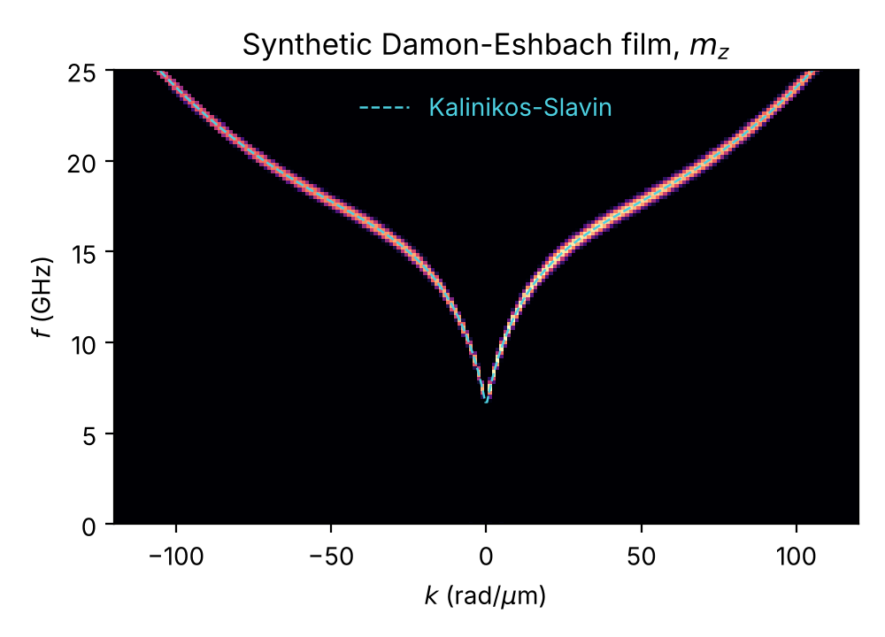

# spin-wave-dispersion

[](https://github.com/Les-nik/spin-wave-dispersion/actions/workflows/tests.yml)

Python tools for turning a [MuMax3](https://mumax.github.io/) simulation into a spin-wave
dispersion relation f(k) and spatial mode profiles.



*Dispersion of the lowest mode of a 30 nm permalloy-like film in the Damon-Eshbach
geometry. The image is computed by the package from a folder of OVF files; the dashed
line is the Kalinikos-Slavin formula used to generate those files
([`examples/synthetic_demo.py`](examples/synthetic_demo.py)).*

## What it does

A typical workflow in magnonics simulations:

1. Excite a magnetic structure with a short pulse that contains a broad range of
   frequencies and wavenumbers.
2. Save the magnetization in every cell at regular time steps.
3. Fourier transform the result over time and space. Bright lines in the (k, f)
   plane are the spin-wave branches.

This package covers steps 2 and 3:

| Module | Purpose |
| --- | --- |
| `swdispersion.ovf` | Reader and writer for OVF 2.0 files (binary float32, float64 and text) |
| `swdispersion.series` | Loads a whole `autosave` folder, reducing each file as it is read so multi-GB runs fit in memory |
| `swdispersion.dispersion` | 2D FFT over (t, x) and single-frequency mode profiles |
| `swdispersion.theory` | Kalinikos-Slavin dispersion of a thin film, for comparison |
| `swdispersion.plotting` | Dispersion and mode-profile figures |

Only NumPy and Matplotlib are needed.

## Installation

```bash
git clone https://github.com/Les-nik/spin-wave-dispersion.git
cd spin-wave-dispersion
pip install -e .
```

## Quick start

Run the example simulation (needs MuMax3 and an NVIDIA GPU, about a minute):

```bash
mumax3 examples/film_dispersion.mx3
```

Plot its dispersion from the command line:

```bash
python -m swdispersion examples/film_dispersion.out --component z --fmax 25 --kmax 120
```

`--save run.npz` also stores the reduced time series. That file is a few MB instead of
the full OVF folder, so it can be copied from a cluster and analysed on a laptop:

```bash
python -m swdispersion run.npz --fmax 25
```

The same steps in Python:

```python
from swdispersion import load_series, compute_dispersion, mode_profile
from swdispersion.plotting import plot_dispersion

series = load_series("examples/film_dispersion.out", component="z", start=1)
disp = compute_dispersion(series.data, series.dt, series.dx)
plot_dispersion(disp, fmax=25e9, kmax=120e6)

profile = mode_profile(series.data, series.dt, frequency=12e9)  # complex, shape (nz, nx)
```

No GPU? `python examples/synthetic_demo.py` builds a fake MuMax3 output folder with a known
dispersion and runs the whole pipeline on it.

## Details

**Sign of k.** NumPy's FFT uses `exp(-i ...)` on every axis, so a plain `fft2` over (t, x)
places a wave travelling in +x at negative k once only positive frequencies are kept. For
reciprocal systems the plot looks the same, but for non-reciprocal ones (interfacial DMI,
Damon-Eshbach surface modes) the two directions get swapped. Here time is transformed with
`exp(+i 2 pi f t)`, so +k always means propagation along +x. A test checks this.

**Time step.** MuMax3 writes an autosave file at the first solver step after each sampling
interval, so the spacing between files jitters slightly. `TimeSeries.dt` is the slope of a
linear fit to all snapshot times, and `load_series` warns if the spacing varies by more than
5 %, which usually means a missing file.

**Window and static part.** Before the FFT the time average of every cell is subtracted (this
removes the large f = 0 peak from the static magnetization) and a Hann window is applied
along time (this reduces leakage from cutting the signal at the end of the run).

**Memory.** A run of 400 snapshots on a 1430 x 10 x 58 grid is about 4 GB of float32 data.
`load_series` keeps only one component and, by default, averages over y while reading,
which in that case brings it down to about 130 MB.

**Mode profiles.** `mode_profile` computes the Fourier component at one frequency in every
cell. Its absolute value is the precession amplitude and its angle the phase, so standing
and travelling waves can be told apart.

## Tests

```bash
pip install -e ".[test]"
pytest
```

The tests cover OVF round trips in all three data formats, the axis order, the k sign for
waves moving in both directions, mode profiles of a standing wave, time-step fitting with
jitter, and limits of the analytical formula.

## Background

I wrote this during my PhD in computational physics (ENIB, Brest, and Adam Mickiewicz
University, Poznań), where I simulate spin waves in magnetic nanostructures with MuMax3 and
COMSOL. The code collects the postprocessing steps I used across several projects into one
tested package.

## License

MIT, see [LICENSE](LICENSE).
